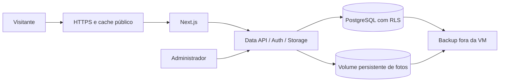

# Viabilidade do Oracle Cloud para o BS Suplementos

Pesquisa: **2026-11-13**. @author Carla Evelyn.

<!-- Problema: comparar a mensalidade de um backend gerenciado com uma VM gratuita
sem mapear banco, Auth, fotos e manutenção pode levar a uma migração incompleta.
Este parecer separa capacidade anunciada, compatibilidade do código e operação.
Data: 2026-11-13. @author Carla Evelyn -->

## Parecer

**O Oracle Cloud Always Free é um candidato viável para reduzir o custo de infraestrutura desta loja.** A opção com menor mudança no código é hospedar a versão aberta do Supabase na própria Oracle e, em uma etapa posterior, o Next.js no mesmo ambiente. Isso retira a dependência do serviço hospedado em supabase.com, preservando sua tecnologia de banco, autenticação e Storage.

Para abandonar também a tecnologia Supabase, o caminho é Next.js + PostgreSQL + armazenamento de fotos + autenticação própria baseada em uma biblioteca mantida. Exige substituir as integrações de Auth, permissões, consultas e uploads. O catálogo visual, carrinho, galerias e conversão de fotos podem ser reaproveitados.

Esta é uma avaliação de arquitetura e documentação oficial, **sem provisionamento, teste de carga em ARM, acesso à conta Oracle, migração de dados ou mudança de DNS**. Capacidade real e custo total ainda dependem da conta, região e consumo. Nas capturas anteriores, o projeto Supabase estava no Free: se continua assim, a mensalidade já é zero; o objetivo passa a ser ganhar margem de recursos e evitar a necessidade do plano pago.

## Oferta consultada

| Recurso                                     | Informação consultada                                                            | Consequência para o projeto                                                                               |
| ------------------------------------------- | -------------------------------------------------------------------------------- | --------------------------------------------------------------------------------------------------------- |
| Compute Ampere A1                           | 1.500 OCPU-h e 9.000 GB-h/mês, equivalentes a 2 OCPUs e 12 GB de RAM contínuos   | Candidato para uma VM pequena, dentro da soma de todos os recursos da conta                               |
| Block Volume                                | 200 GB compartilhados entre volumes elegíveis, incluindo discos de inicialização | Espaço consumido também por sistema, banco, fotos, logs e cache                                           |
| Saída de dados                              | 10 TB/mês incluídos no Always Free                                               | Margem de transferência maior; não equivale a capacidade ilimitada de processamento                       |
| Object Storage em conta somente Always Free | 20 GB combinados e 50 mil operações API/mês                                      | Não usar essa franquia de operações como se fosse ilimitada; fotos podem permanecer em volume persistente |

Fonte: [recursos Always Free da Oracle](https://docs.oracle.com/en-us/iaas/Content/FreeTier/freetier_topic-Always_Free_Resources.htm).

O guia principal de [Free Tier](https://docs.oracle.com/en-us/iaas/Content/FreeTier/freetier.htm) também informa o teto de 2 OCPUs/12 GB ao terminar o período de teste. Há uma divergência documental: a página [Arm-Based Compute](https://docs.oracle.com/en-us/iaas/Content/Compute/References/arm.htm) ainda cita 3.000/18.000 horas, números associados a 4 OCPUs/24 GB. Esta avaliação usa o limite mais conservador do Free Tier e exige conferir **Limits, Quotas and Usage** na conta antes de dimensionar.

Always Free não tem o prazo fixo de 30 dias dos créditos promocionais. A oferta continua sujeita às condições do serviço, elegibilidade e limites; não é garantia contratual de que todas as franquias permanecerão iguais. O [FAQ](https://www.oracle.com/cloud/free/faq/) informa que a conta exige verificação, pode enfrentar falta de capacidade e não inclui SLA nem suporte técnico padrão. Compute gratuito deve ser criado na região principal elegível; escolher a região é uma decisão anterior à migração.

A Oracle pode recolher VMs ociosas: a definição documentada considera uma janela de sete dias, CPU no percentil 95 abaixo de 20%, rede abaixo de 20% e memória abaixo de 20% para A1. Um catálogo pequeno pode ter baixo uso legítimo. A operação precisa aceitar esse risco e ter restauração em outro servidor; não se deve depender de gerar carga artificial para sustentar o ambiente.

## O que existe no código

| Parte            | Integração atual                                            | Trabalho para mudar                                                                                   |
| ---------------- | ----------------------------------------------------------- | ----------------------------------------------------------------------------------------------------- |
| Catálogo público | `lib/catalog-server.ts`, API REST e chave pública anônima   | Preservar API compatível ou substituir por consultas PostgreSQL no servidor                           |
| Painel           | `components/admin-dashboard.tsx`, CRUD direto pelo SDK      | Manter Data API/RLS ou criar rotas administrativas autorizadas                                        |
| Login/senha      | Clientes SSR, cookies e métodos de Supabase Auth            | Migrar usuários/configuração ou substituir sessão, hash de senha e recuperação por biblioteca mantida |
| Permissões       | `profiles`, `auth.users`, `auth.uid()`, policies e triggers | Preservar schemas e papéis no self-hosted; redesenhar se for PostgreSQL sem Supabase                  |
| Fotos            | Bucket `catalog`, `lib/images/upload.ts`, URLs públicas     | Copiar bytes e metadados, manter autorização de upload e atualizar referências                        |
| Entrega de mídia | `lib/media.ts`, `app/media/[...path]/route.ts`, sharp/HEIC  | Preservar a URL canônica e validar bibliotecas no runtime ARM                                         |
| Cache            | Cabeçalhos HTTP e `Vercel-CDN-Cache-Control`                | Configurar cache no novo proxy/CDN; o cabeçalho específico da Vercel não o configura sozinho          |

O banco de dados gratuito Oracle Autonomous utiliza tecnologia Oracle. Ele não substitui diretamente o PostgreSQL com `auth.uid()`, arrays, policies e funções existentes. A proposta avaliada usa PostgreSQL instalado na VM, diretamente ou como parte da distribuição aberta do Supabase, e não uma simples troca para Autonomous Database.

## Opção A: Supabase aberto hospedado na Oracle

A ideia é manter banco, login, funções de permissão, bucket e SDK compatíveis, reduzindo a reescrita. O painel da própria loja continua existindo. O Studio do Supabase pode continuar disponível para manutenção, protegido de acesso público indevido; seus recursos gerenciados de múltiplos projetos, backups/PITR e métricas não são equivalentes aos da plataforma hospedada.

A [documentação oficial de Docker](https://supabase.com/docs/guides/self-hosting/docker) informa mínimo de 2 núcleos, 4 GB de RAM e 40 GB de SSD para o conjunto de componentes; recomenda mais recursos. Portanto, a franquia A1 é um candidato para teste, não um benchmark aprovado para esta aplicação. Podemos avaliar uma composição com apenas serviços usados, verificando dependências e suporte ARM64 de cada imagem fixada. O código atual não utiliza Realtime nem Edge Functions.

O Storage pode continuar com backend de arquivos e volume persistente, com backup de fotos separado do banco. Não é obrigatório colocar cada foto em OCI Object Storage para usar Oracle Cloud. R2 é outra opção para mídia, mas requer adaptação, credenciais de servidor e migração próprias.

Hospedar o Next.js na mesma VM também pode substituir a Vercel. Para esta fase, usar produção com `next start` ou imagem standalone, HTTPS e proxy à frente do Node. Não servir `npm run dev` ao público. As orientações de [self-hosting do Next.js](https://nextjs.org/docs/app/guides/self-hosting) pedem atenção a proxy, cache, builds e múltiplas instâncias.

A contrapartida é operacional: a equipe assume atualização do sistema e containers, manutenção do Postgres, backups, restauração, monitoramento e recuperação de falhas. São responsabilidades explicitadas pelo [Supabase self-hosted](https://supabase.com/docs/guides/self-hosting). Uma VM única também concentra falhas do site, banco e arquivos.

## Opção B: retirar também a tecnologia Supabase

Para esta loja, seria possível concentrar a aplicação em Next.js, PostgreSQL e arquivos/armazenamento de objetos. O servidor passaria a consultar o banco e validar cada operação administrativa. O navegador deixaria de fazer CRUD diretamente pelo SDK do Supabase.

São mudanças de implementação necessárias:

- Adaptador de banco e endpoints públicos/administrativos com validação de entrada.
- Sessões e autorização com biblioteca mantida; proteção de cookies e das operações mutáveis.
- Migração de identidades, perfis e política de redefinição de senha; um login existente não se transforma automaticamente em outra solução de Auth.
- Upload autorizado com compressão e nomes de conteúdo preservados.
- Migração de SQL dependente de schemas/funções do Supabase e testes de acesso de visitante/viewer/admin.

Não é necessário reescrever a interface ou eliminar o PostgreSQL para fazer essa troca. Porém, é mais trabalho e risco de regressão que a opção A. Para economia imediata com menor alteração no projeto, priorizaria a opção A; para simplificar a arquitetura no longo prazo e aceitar investimento em refatoração, a B merece uma branch de prova de conceito.

## E-mail, fotos e continuidade

O erro já observado `429: email rate limit exceeded` é um limite do envio de recuperação de senha. Ele exige configurar SMTP e seus limites, independentemente da escolha de banco/hospedagem. Self-hosted também exige um serviço real de envio e configuração de remetente, retorno e domínio.

Não foi assumido que OCI Email Delivery já está habilitado: a página de Always Free anuncia franquia de envio, mas a tabela de [Limits by Service](https://docs.oracle.com/en-us/iaas/Content/General/service-limits/default.htm) consultada mostra limite diário zero para contas somente Always Free e diferentes limites para Trial/PAYG. É necessário confirmar a habilitação na conta ou usar outro SMTP. Remetente e domínio precisam ser configurados conforme a [documentação de Email Delivery](https://docs.oracle.com/en-us/iaas/Content/Email/Concepts/overview.htm).

As fotos devem continuar usando WebP comprimido, hash estável e cache. No novo proxy, cachear somente respostas públicas elegíveis; respeitar os caminhos de checkout com atualização e não cachear administração, sessão, recuperação de senha nem respostas `no-store`. Uma migração que encaminhe toda visita ao servidor de imagens sem cache pode recriar o consumo e o processamento que esta revisão corrigiu.

Os backups devem incluir banco, configurações/segredos necessários à restauração e **bytes das fotos**, fora da VM de origem. Exportar só `public` ou guardar só uma cópia no mesmo disco não preserva toda a aplicação. A documentação oficial separa [restauração do projeto](https://supabase.com/docs/guides/self-hosting/restore-from-platform) e [cópia dos objetos de Storage](https://supabase.com/docs/guides/self-hosting/copy-from-platform-s3).

## Comparação econômica para decidir

| Caminho                                      | Custo direto possível                                            | Esforço e manutenção                                                                     |
| -------------------------------------------- | ---------------------------------------------------------------- | ---------------------------------------------------------------------------------------- |
| Serviço gerenciado atual                     | Zero enquanto o Free servir; Pro anunciado a partir de US$25/mês | Menos manutenção própria; sujeito às franquias contratadas                               |
| Oracle Always Free + Supabase aberto         | US$0 para recursos elegíveis dentro dos limites                  | Provisionamento, backups e manutenção próprios; capacidade e ociosidade são riscos reais |
| Oracle Always Free + PostgreSQL/novo backend | Mesma possibilidade de infraestrutura gratuita                   | Mais refatoração inicial; operação do servidor permanece                                 |
| Supabase Free + R2 para mídia                | Pode ficar nas franquias gratuitas de ambos                      | Mantém Auth/banco gerenciados e exige adaptar a camada de mídia                          |
| VPS paga pequena com stack próprio           | Cotação necessária; pode ser comparada ao custo total atual      | Não depende da disponibilidade Always Free; continua exigindo operação e backup          |

Referências de valores: [Supabase](https://supabase.com/pricing) e [Cloudflare R2](https://developers.cloudflare.com/r2/pricing/). A franquia Standard de R2 inclui 10 GB-mês, 1 milhão de operações A e 10 milhões B; a saída direta de R2 é gratuita. Operações, armazenamento excedente e outros produtos podem ser cobrados.

Domínio, SMTP, backup externo, monitoramento, excedentes e tempo de manutenção entram no orçamento. Se a conta Oracle for convertida para PAYG, uso acima da gratuidade pode gerar cobrança; a [documentação de custos da Oracle](https://docs.oracle.com/en/solutions/oci-best-practices/track-and-manage-usage-and-cost1.html) explica que alertas de orçamento não bloqueiam automaticamente os gastos. Esta pesquisa não calculou uma fatura real nem verificou as franquias disponíveis na conta da loja.

Também há o frontend: o [Vercel Hobby](https://vercel.com/docs/plans/hobby) é destinado a uso pessoal não comercial. O orçamento desta loja precisa considerar hospedagem comercial adequada ou mover também o Next.js. Migrar só o Supabase não altera a condição/plano da Vercel.

## Ordem proposta para uma migração

1. Confirmar conta Oracle, região, disponibilidade efetiva de A1, franquias e elegibilidade depois do Trial. Decidir quanto de indisponibilidade e manutenção a loja aceita.
2. Criar ambiente paralelo com versões fixadas e suporte ARM64 verificado, sem alterar o domínio principal. Definir backup externo e comprovar uma restauração.
3. Validar um conjunto de dados de teste: visitante não escreve, viewer não administra, admin consegue CRUD, upload JPEG/HEIC, galeria/capa, login e recuperação com SMTP real.
4. Inventariar tabelas, identidades, permissões, fotos e todos os campos de URL. Fazer cópia usando os roteiros oficiais; o SQL da aplicação sozinho não exporta dados nem usuários.
5. Migrar também `image_url`, `image_urls`, `hero_image_url`, `hero_image_urls`, `logo_url` e imagens de categorias. A validação de origem em `lib/media.ts` rejeita URLs do provedor antigo quando a origem configurada muda.
6. Atualizar domínio de API, chaves públicas/configuração Auth e CSP. As variáveis `NEXT_PUBLIC_*` exigem novo build. Segredos e credenciais de servidor não podem ir para esses campos públicos.
7. Se mover a Vercel, validar build Node/ARM, cache público, HTTPS e rotinas de reinício/deploy. Confirmar uma transferência por foto visitada e ausência de respostas privadas em cache.
8. Com a cópia validada, planejar uma curta janela sem alterações administrativas para sincronizar os últimos dados; trocar o tráfego e monitorar. Manter a origem disponível para rollback durante a validação, conciliando novas escritas se houver retorno.
9. Só encerrar o serviço antigo após validar dados, arquivos, operação e recuperação. A primeira etapa de teste não exige excluir nem contratar nada no ambiente atual.

## Próxima decisão

Validaria primeiro se é possível obter a VM elegível na conta/região e restaurar o projeto em um ambiente paralelo. Se isso funcionar e a loja aceitar a manutenção própria, Oracle é uma opção concreta de economia. Se a prioridade for manter operação gerenciada e o problema restante forem apenas as fotos, Supabase Free + R2 tende a exigir uma mudança menor. Nenhuma migração foi executada como parte desta pesquisa.
