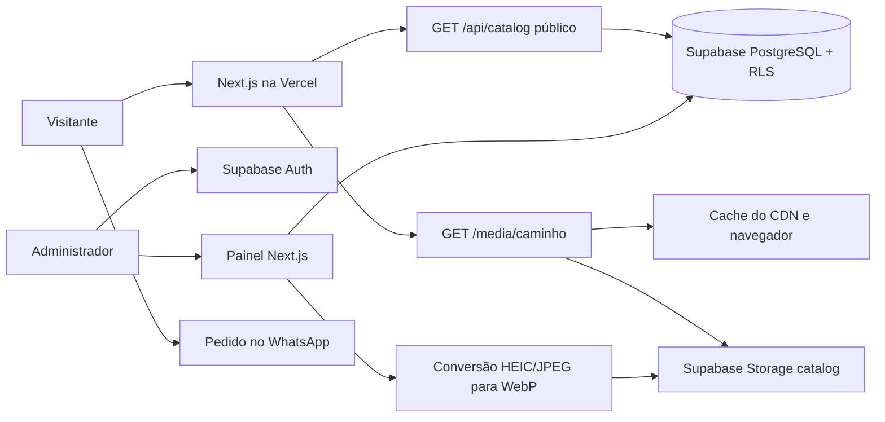
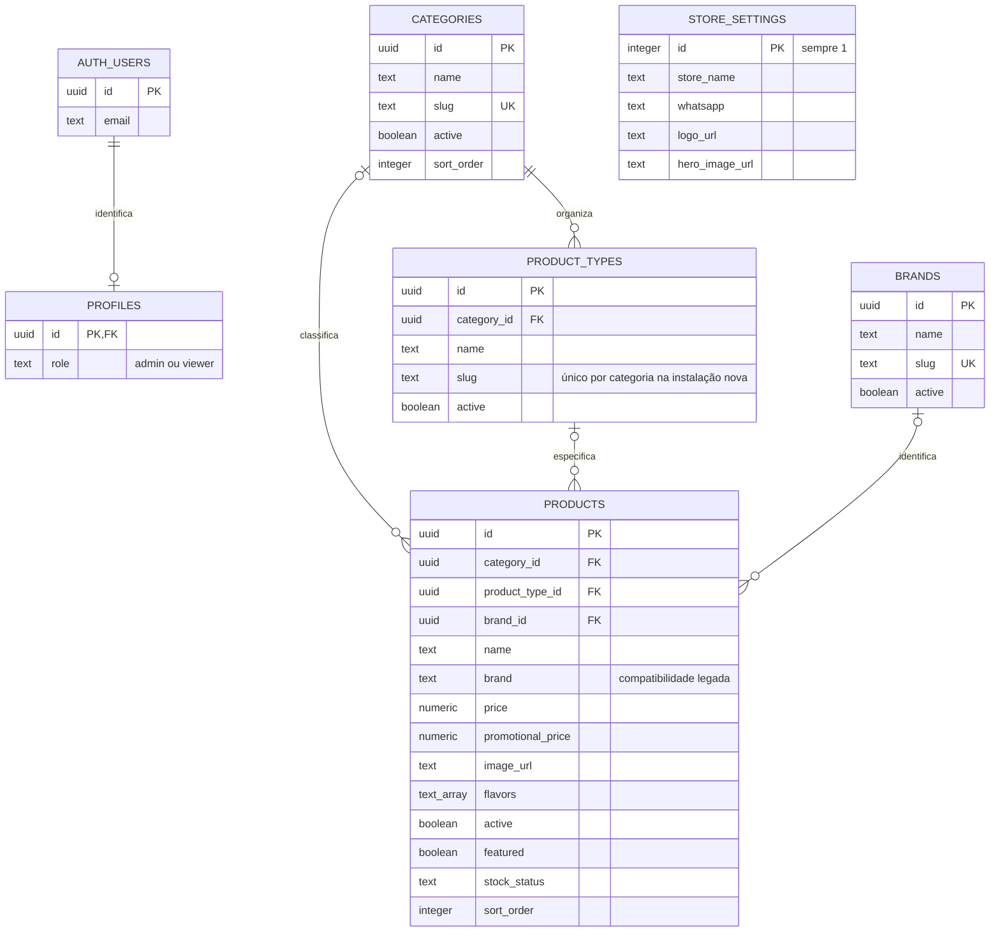

# Projeto de software — BS Suplementos

**Responsável pela revisão:** Carla Evelyn. **Versão desta revisão:** 2026-11-12.

## 1. Objetivo e escopo

A loja apresenta suplementos, organiza produtos em categorias/tipos/marcas, oferece sabores e monta um pedido para atendimento no WhatsApp. Os valores são estimados; a loja confirma estoque, entrega e pagamento. Não há gateway de pagamento, cálculo de frete, reserva de estoque ou persistência de pedidos no banco.

Visitantes usam `/`. Administradores autenticados usam `/admin/login` e `/admin`. A recuperação do acesso usa a rota pública `/redefinir-senha`. A função no perfil autoriza o acesso: ter uma conta válida não equivale a ser administrador.

## 2. Arquitetura



A aplicação usa Next.js 16, React 19 e TypeScript estrito. `sharp` comprime imagens antigas no servidor; `heic-convert` decodifica HEIC legado. `heic-to/csp` é carregado dinamicamente somente no painel quando uma foto HEIC/HEIF é escolhida. JPEG/PNG/WebP usam os recursos nativos do navegador. Nenhuma chave secreta é necessária no aplicativo.

## 3. Organização do código

| Caminho                                                      | Responsabilidade                                                    |
| ------------------------------------------------------------ | ------------------------------------------------------------------- |
| `app/page.tsx`                                               | Entrada do catálogo                                                 |
| `components/storefront.tsx`                                  | Interface, busca, categorias/tipos e pedido                         |
| `components/admin-dashboard.tsx`                             | Gerenciamento e formulários tipados                                 |
| `components/catalog-image.tsx`                               | Imagem com URL canônica, lazy loading e fallback                    |
| `components/admin/product-editor.tsx`, `taxonomy-editor.tsx` | Formulários isolados de produto e organização                       |
| `components/admin/image-upload.tsx`                          | Upload, progresso, erros e prévia                                   |
| `components/modal.tsx`                                       | Diálogo, foco, Escape e bloqueio de rolagem                         |
| `hooks/use-cart.ts`                                          | Estado e persistência mínima do carrinho                            |
| `lib/cart.ts`                                                | Validação, migração do carrinho e reconciliação                     |
| `lib/images/prepare.ts`                                      | Conversão, redução, remoção de EXIF e hash                          |
| `lib/media.ts`                                               | Mapeamento seguro das URLs do Storage                               |
| `lib/catalog-errors.ts`                                      | Diagnósticos de configuração, schema, RLS e conexão sem credenciais |
| `lib/catalog-server.ts`                                      | Leitura pública anônima do catálogo                                 |
| `lib/store.ts`                                               | Cache curto e deduplicação de consultas no cliente                  |
| `lib/supabase/client.ts`                                     | Cliente Supabase do navegador                                       |
| `lib/supabase/proxy.ts`, `proxy.ts`                          | Validação de sessão/perfil apenas em `/admin`                       |
| `lib/security/sanitize.ts`                                   | Normalização de textos, números e contatos                          |
| `supabase/schema.sql`                                        | Fonte única para instalar/atualizar o banco                         |
| `tests/`                                                     | Regressões de dados, SQL e navegador                                |
| `.github/workflows/ci.yml`                                   | Verificações automatizadas                                          |

## 4. Modelo de dados e relações SQL



`profiles.id` referencia `auth.users.id` com exclusão em cascata. O perfil não é criado nem promovido pelo visitante. A atribuição inicial do administrador é feita pelo SQL Editor.

`products.category_id`, `products.product_type_id` e `products.brand_id` são opcionais e têm `ON DELETE SET NULL`. `product_types.category_id` é obrigatório e usa `ON DELETE CASCADE`: excluir uma categoria remove seus tipos, mas preserva os produtos, desvinculando as respectivas referências.

O trigger `catalog_product_relations` impede ligar um produto a um tipo de outra categoria. `catalog_type_category` impede mover um tipo que ainda possui produtos vinculados a outra categoria. O painel limpa o tipo ao trocar a categoria do produto.

O campo `products.brand` é mantido para compatibilidade com a versão anterior. Na atualização, marcas legadas recebem registros em `brands` e seus produtos recebem `brand_id`. O trigger copia o nome ao salvar o produto; a API pública resolve o nome atual pela relação. Nomes/IDs existentes não são apagados.

Produtos/categorias/tipos/marcas têm `active` e `sort_order`. Produtos também têm `featured`, preços opcionais e estoque `available`, `low` ou `unavailable`. `flavors` é um array PostgreSQL `text[]`. Ausência de preço significa valor sob consulta; zero é tratado como valor válido.

Preços devem ser não negativos. A promoção nova deve ter preço normal e ser menor que ele. O constraint de promoção usa `NOT VALID` na migração para não apagar nem bloquear a instalação por um registro legado inválido; novas inserções/atualizações já são validadas. Registros anteriores fora dessa regra precisam ser corrigidos no painel antes de validar integralmente o constraint.

Índices atendem às FKs, à categoria de tipos e à ordenação dos produtos ativos. Triggers atualizam `updated_at` nas tabelas gerenciadas. `created_at` registra a criação. `store_settings` contém um único registro, com `id = 1`, para nome, frase, WhatsApp, Instagram, endereço, cores, logotipo e capa.

`storage.objects` e `storage.buckets` pertencem ao Supabase. As colunas `image_url`, `logo_url` e `hero_image_url` apontam logicamente para objetos públicos de `catalog`; não há FK entre uma URL e o Storage. Excluir um produto não exclui automaticamente a imagem: outros registros podem compartilhar o mesmo arquivo.

## 5. Autorização e validação

| Recurso                                 | Visitante  | Viewer autenticado | Admin                          |
| --------------------------------------- | ---------- | ------------------ | ------------------------------ |
| Produtos/categorias/tipos/marcas ativos | Ler        | Ler                | Ler todos e gerenciar          |
| Configurações da loja                   | Ler        | Ler                | Ler e atualizar                |
| Perfil                                  | Sem acesso | Ler o próprio      | Ler o próprio                  |
| Fotos públicas                          | Ler        | Ler                | Ler, enviar, alterar e excluir |

A função `is_admin()` consulta o perfil usando `auth.uid()`, com `SECURITY DEFINER` e `search_path` fixo. Nenhum usuário do aplicativo pode alterar o próprio perfil. As permissões do painel são aplicadas novamente pelo banco com RLS; esconder botões não é autorização.

O proxy protege somente `/admin`: páginas públicas, fotos e catálogo não renovam sessões nem acionam Supabase Auth a cada visita. Cookies de renovação/logout são preservados nos redirects. Respostas administrativas têm `private, no-store`.

A CSP restringe fontes e conexões. Há proteção contra enquadramento, MIME sniffing e envio desnecessário de referrer. `wasm-unsafe-eval` atende ao decodificador HEIC; `unsafe-eval` de JavaScript só existe no desenvolvimento. `unsafe-inline` permanece para o runtime padrão do Next.js; uma política por nonce exigiria renderização dinâmica e precisa de avaliação separada.

A sanitização no frontend melhora a qualidade das entradas. RLS, constraints, FKs, triggers e regras do Storage fazem as verificações persistentes. Desative cadastro público no Supabase e use senha exclusiva para o administrador.

### Recuperação e nova senha

O link **Alterar senha** fica abaixo do campo de senha no login. A rota pública
`/redefinir-senha` solicita o e-mail ou mostra a nova senha quando o Supabase
validou um link de recuperação. Links enviados pelo Dashboard à Site URL são
encaminhados para essa rota, sem consultas extras no catálogo. O fluxo trata
tokens do Dashboard, PKCE do aplicativo e TokenHash de template personalizado.

A senha é gravada por `auth.updateUser`, no Supabase Auth; não é armazenada nas
tabelas do catálogo. Após a alteração, a sessão de recuperação deste navegador é
encerrada e um novo login é solicitado. O perfil e as regras RLS permanecem os
mesmos. Configuração, limites e testes estão em `RECUPERACAO-DE-SENHA.md`.

## 6. Fluxo e orçamento das imagens

O comportamento anterior usava `next/image` com tamanhos diferentes: o card e a miniatura do carrinho podiam gerar URLs distintas e novas transformações. Reaparecer um elemento no DOM, sozinho, não significa baixar novamente; a combinação de URL estável e cabeçalho de cache é que permite reutilizar os bytes.

**Upload novo:** entrada de até 20 MB → decodificação JPEG/HEIC/HEIF/PNG/WebP → canvas de até 1200 × 1200, preservando proporção → WebP de até 350.000 bytes → SHA-256 → `catalog/v2/<hash>.webp`. O canvas elimina metadados EXIF/GPS. O painel rejeita entradas acima de 60 megapixels e mostra erros sem interromper os demais formulários. Qualidade diminui progressivamente se necessário para respeitar o teto de bytes.

O upload usa `upsert: false` e `cacheControl: 31536000`. Um conflito de conteúdo já existente é confirmado pelo Storage e reutiliza a mesma URL. A conversão HEIC não é baixada pelo visitante do catálogo.

**Entrega:** todas as telas pedem `/media/<caminho-do-objeto>`. A rota aceita somente o bucket público da origem configurada, sem URLs externas nem redirecionamentos do upstream. Parâmetros de query são redirecionados para o caminho canônico, evitando variantes de tamanho ou cache-busters. Originais antigos viram WebP de até 1200 px no primeiro cache miss; HEIC antigo também é convertido. WebP novo adequado passa sem outra recompressão.

| Resposta                   | Cache do navegador                                               | CDN da Vercel                    |
| -------------------------- | ---------------------------------------------------------------- | -------------------------------- |
| Foto nova `v2/<hash>.webp` | 1 ano, immutable                                                 | 30 dias + 1 dia de SWR           |
| Foto legada                | 1 dia + 7 dias de SWR                                            | 30 dias + 1 dia de SWR           |
| Arte local `/brand/`       | Cabeçalho configurado para 1 dia; confirmar o efetivo no Preview | Conforme hospedagem de estáticos |
| Falha de imagem            | `no-store`                                                       | Não deve ser armazenada          |

SWR permite servir uma cópia enquanto o cache é revalidado em segundo plano. TTL não garante retenção: o CDN pode expulsar um objeto antes disso. No deploy e em regiões diferentes pode haver novos cache misses. Primeiras leituras continuam consumindo Supabase; respostas do CDN continuam consumindo requisições/banda Vercel. Esta solução elimina o uso do serviço de otimização `/_next/image` na interface, mas não torna a hospedagem ilimitada.

Limites de leitura legada: 20 MB por objeto e 40 megapixels no processamento sharp. Fotos acima desses limites precisam ser reenviadas pelo painel. Objetos antigos em hosts externos ao Supabase configurado recebem fallback: devem ser importados para o bucket. Troque uma foto enviando outra, com novo hash; nunca sobrescreva um objeto com cache immutable.

Não há exclusão automática de arquivos antigos ou cache de todos os produtos por service worker. Essa decisão evita apagar imagens compartilhadas ou armazenar o catálogo inteiro no celular sem necessidade.

## 7. Catálogo, carrinho e WhatsApp

`GET /api/catalog` faz consultas anônimas, respeitando RLS, e retorna apenas os campos usados. Não acessa cookies nem envia dados administrativos. A resposta tem cache de 60 segundos no navegador/CDN e SWR de 300 segundos. O cliente também deduplica consultas concorrentes e mantém o resultado por 60 segundos. Falhas em configurações da loja, categorias ou produtos retornam HTTP 503, sem trocar a loja por dados de demonstração. Tipos/marcas são auxiliares: se falharem, os produtos reais continuam disponíveis, com diagnóstico operacional e resposta `no-store`. Quando apenas as colunas novas de produto estão ausentes, uma consulta adicional aos campos legados permite leitura compatível até concluir a migração; isso não habilita o painel completo sem SQL atualizado.

O limite de conexão é de 20 segundos para permitir inicializações mais lentas do Supabase. Não há retries automáticos nem polling. Em desenvolvimento, `/api/catalog?fresh=1` informa `diagnostics` com recurso, código e orientação. Em produção, o navegador recebe a mensagem genérica e os diagnósticos seguros ficam nos logs do servidor. Nunca são registrados chaves, cabeçalhos, linhas de produtos ou mensagens brutas do banco. DNS/TLS/timeout são identificados separadamente de erros de schema/RLS.

A chave `bs-cart` no `localStorage` guarda somente `id`, `flavor` e `quantity`. O parser tolera JSON corrompido, elimina entradas inválidas, agrupa duplicatas e limita quantidades a 99. Formatos antigos com produtos completos são migrados. Os itens exibidos são reconciliados com o catálogo: preço, marca, foto e disponibilidade atuais substituem as cópias antigas. O modo privado pode usar o carrinho em memória.

Ao finalizar, `GET /api/catalog?fresh=1` solicita dados sem cache. Se preços/itens/sabores mudaram, a tela atualiza o pedido e pede nova conferência. Depois mostra o link de envio ao WhatsApp; o clique explícito funciona com bloqueadores de popup no iPhone. O pedido inclui produto, marca, sabor, quantidade e soma dos itens com preço. A loja ainda confirma estoque/pagamento: não há reserva ou garantia transacional entre a consulta e a conversa.

Modais prendem o foco, fecham por Escape e devolvem o foco ao controle de origem. Busca inclui nomes de categorias. Há limite de quantidade, mensagens de status, bloqueio de salvamento durante upload e campos tipados no painel.

## 8. Instalação, atualização e rollback

1. Faça backup do banco e dos objetos do Storage. Exportar PostgreSQL não exporta os bytes das fotos.
2. Crie um Supabase de teste; restaure uma cópia sem dados sensíveis ou use cadastros fictícios.
3. Execute `supabase/schema.sql` inteiro no SQL Editor. Ele usa transação e é idempotente para as estruturas/políticas conhecidas. Não apaga produtos nem reinicia cadastros.
4. Se produção recebeu mudanças SQL manuais, compare-as primeiro. FKs novas podem rejeitar referências órfãs: corrija os vínculos na cópia antes de repetir. Uma falha aborta a transação; não significa que metade da atualização foi aplicada.
5. Crie o usuário e atribua `admin`. As instruções estão ao final do schema.
6. Na Vercel, configure Preview com a URL/key desse banco e selecione a branch. Use Node.js 24 e `npm ci`/`npm run build`.
7. Valide upload, preço, sabores, administração e cache. Só depois aplique o SQL no banco real e promova a versão.

A migração substitui as políticas com os nomes conhecidos da aplicação. Políticas manuais extras continuam existindo e podem ampliar permissões: revise `pg_policies`. Não há credenciais ou introspecção do banco de produção neste repositório que permitam afirmar sua configuração exata.

O rollback do frontend é selecionar o deploy anterior na Vercel. As alterações do banco são aditivas e mantêm campos antigos; não remova tabelas/colunas para reverter a interface. Se for necessário reverter dados, use o backup validado. O banco legado permanece com as estruturas novas até revisão específica.

### Compatibilidade com constraints legadas e erro 42P10

`CREATE TABLE IF NOT EXISTS` preserva uma tabela já existente sem acrescentar as
constraints descritas no comando. Por isso, a versão anterior podia exigir
`ON CONFLICT(slug)` em `brands` sem que houvesse `UNIQUE(slug)`. O PostgreSQL então
retorna 42P10, mesmo se nenhum dado estiver repetido.

A inicialização de `store_settings` e a migração de marcas agora usam locks e
`WHERE NOT EXISTS`, sem depender dessas constraints legadas. Configurações já
existentes não são sobrescritas. Se houver mais de uma configuração com id=1, a
migração para com uma mensagem específica para revisar os registros; não escolhe
uma configuração arbitrária.

Em `brands`, o índice único de slug é criado se estiver ausente e os dados forem
compatíveis. Se houver slugs repetidos, a migração preserva as marcas, avisa com
`NOTICE` e deixa o índice pendente de revisão. Produtos que já possuem `brand_id`
mantêm seus vínculos. Para novos vínculos por nome repetido, a escolha é estável:
primeiro uma marca ativa, depois o menor UUID. Não há exclusão ou fusão automática.

## 9. Operação e limpeza

Os logs de depuração com catálogo/cliente Supabase foram removidos. O projeto não inclui rastreador de Analytics por padrão. O README e a `.env.example` refletem as variáveis realmente usadas. Não foram encontrados componentes Lovable no código analisado. Comentários de instrução/edição sem utilidade foram retirados; comentários técnicos relevantes identificam problema, data e Carla Evelyn.

Não exclua produtos/fotos repetidos em produção por suposição. Nomes iguais podem representar embalagens ou sabores distintos, e imagens podem ser compartilhadas. Para inventariar possíveis duplicatas, rode uma consulta somente de leitura:

```sql
select lower(trim(name)) as nome, brand_id, category_id, count(*) as quantidade,
       array_agg(id order by id) as ids
from public.products
group by lower(trim(name)), brand_id, category_id
having count(*) > 1;

select schemaname, tablename, policyname, roles, cmd, qual, with_check
from pg_policies
where schemaname in ('public', 'storage')
order by schemaname, tablename, policyname;

select id, name, price, promotional_price
from public.products
where promotional_price is not null
  and (price is null or promotional_price >= price);
```

Revise os resultados antes de excluir qualquer cadastro ou arquivo. Preserve um período de rollback e a lista de URLs referenciadas em produtos, categorias e configurações antes de limpar Storage. A atualização não faz exclusões destrutivas em dados existentes.

## 10. Verificação e evolução

Veja `docs/VALIDACAO.md` para cenários, comandos e evidências. Veja `docs/HOSPEDAGEM.md` para comparar custos. Meça 7–14 dias após a publicação: Supabase egress/Storage e Vercel transferência, invocações e cache. Separar essas métricas permite decidir se a próxima etapa é só mover fotos para R2 ou migrar todo o backend.
